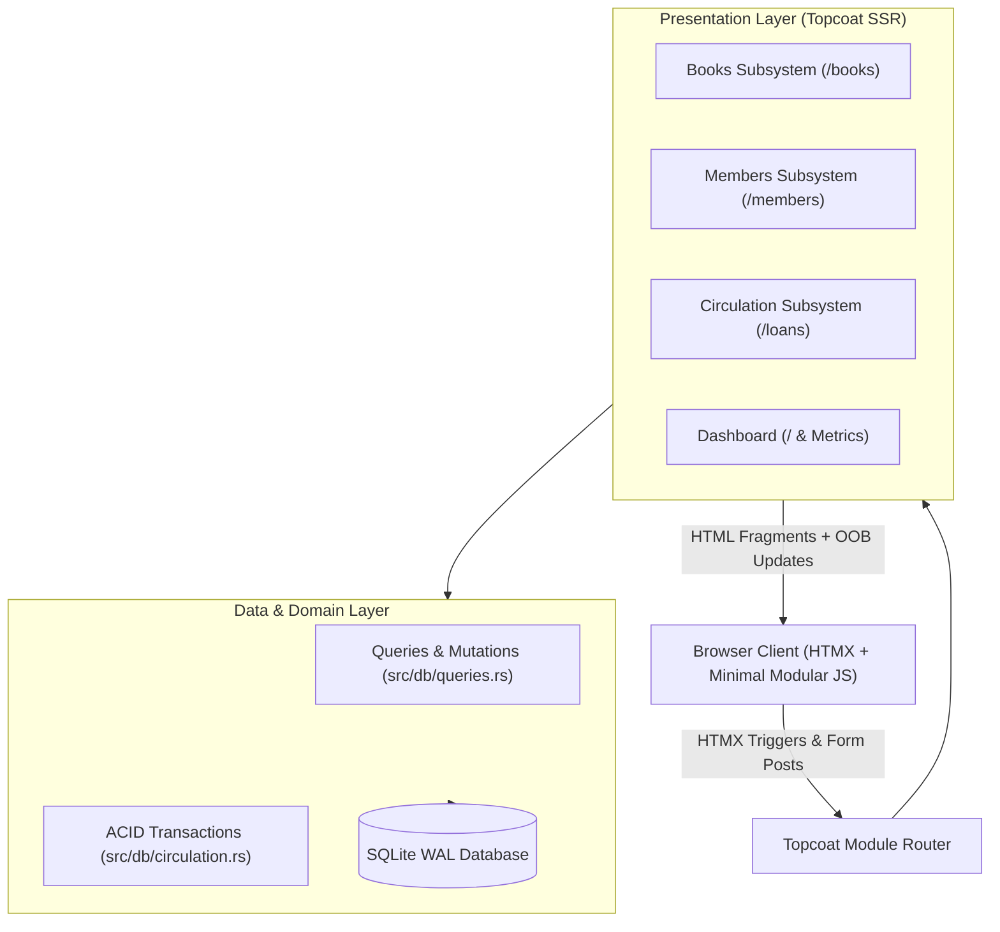

# Micro-Architectural Design: Core Library Modules

**Application:** Library Management System  
**Stack:** Rust, Topcoat (Server-Rendered Views), HTMX, Tailwind CSS (shadcn semantic tokens), SQLite (WAL mode, ACID transactions)  
**Implementation Source:**
- Books Module: [`src/routes/books/mod.rs`](../src/routes/books/mod.rs) & [`views.rs`](../src/routes/books/views.rs)
- Members Module: [`src/routes/members/mod.rs`](../src/routes/members/mod.rs) & [`views.rs`](../src/routes/members/views.rs)
- Circulation Desk: [`src/routes/loans/mod.rs`](../src/routes/loans/mod.rs) & [`views.rs`](../src/routes/loans/views.rs)
- Dashboard: [`src/routes/dashboard.rs`](../src/routes/dashboard.rs)
- Shared UI Components: [`src/components/`](../src/components/)

---

## 1. Architectural Overview & System Flow

---

## 2. Core Subsystems

### 2.1 Books Catalog Subsystem (`/books`)
- **Real-Time Debounced Filtering**: Keyup events (`delay:300ms`) query the catalog by title, author, or ISBN; category selections update the table via partial swaps targeting `#books-table-body`.
- **Zero-Flicker Mutation Cycle**: Add Book and Edit Book modals use standard Topcoat views. Successful mutations trigger:
  - An Out-of-Band (OOB) swap clearing `#modal-container`.
  - An OOB toast alert appended to `#toast-container`.
  - An `HX-Trigger: {"library:data-changed": ...}` event to refresh the table without losing active search inputs.
- **Inventory Safety Constraint**: Edits enforce `total_copies >= borrowed_copies`. Deletions reject if any active or overdue loans exist for the book.

### 2.2 Patrons & Members Subsystem (`/members`)
- **Directory Search**: Instant filtering across member names, emails, and card barcodes.
- **Inline Status Toggling**: One-click toggling between `Active` and `Suspended` statuses returns an updated table row fragment using `hx-swap="outerHTML"`.
- **Slide-Over Profile Drawer**: Clicking "History & Loans" opens an off-canvas drawer populated with patron contact details, active loans, and borrowing history. Dismissible via backdrop click, close button, or Escape key.

### 2.3 Circulation Desk Subsystem (`/loans`)
- **Searchable Combobox Checkout**: Uses `custom_select` with remote search endpoints (`/books/select-options` and `/members/select-options`) to find available stock and eligible patrons without huge DOM dumps.
- **ACID Checkout Guard**: Checkouts execute `issue_loan_tx` within a `BEGIN IMMEDIATE` transaction, atomically decrementing `available_copies WHERE available_copies > 0` to prevent race conditions.
- **One-Click Check In (Return)**: Returns execute `return_book_tx`, atomically marking the loan returned and incrementing shelf stock.
- **Filter Tabs with History**: Filter tabs (`All`, `Active`, `Overdue`, `Returned`) declare `hx-push-url="true"` to ensure browser back/forward and page refresh maintain active filters.

---

## 3. Interactivity & State Directives

1. **Strictly No `#[shard]` or WebSockets**: All views are server-rendered. Dynamic interactions are driven purely by HTMX hypermedia attributes.
2. **Defensive Layout Sizing**: All icons, badges, avatars, and action triggers must declare `shrink-0` and explicit minimum dimensions to prevent layout collapse in flex containers.
3. **Stateless Browser Persistence**: Theme preferences are stored in cookies (`SameSite=Lax; path=/; max-age=...`) and server-rendered on the root layout to avoid flashing unstyled content.
