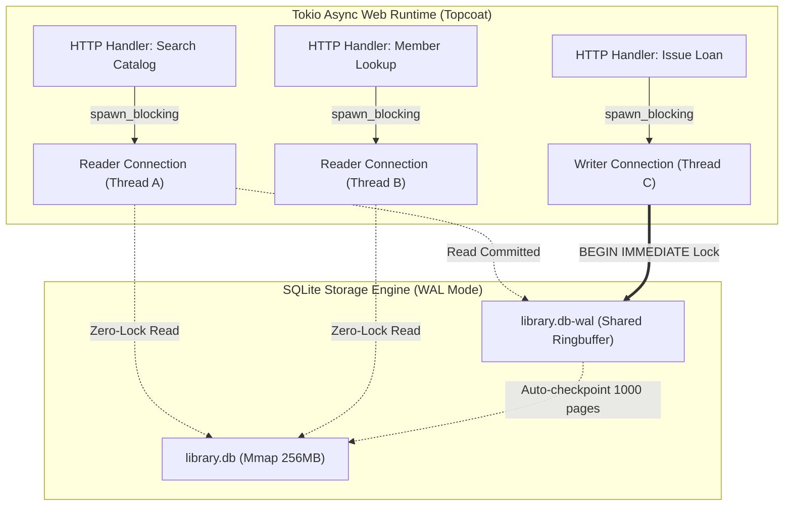
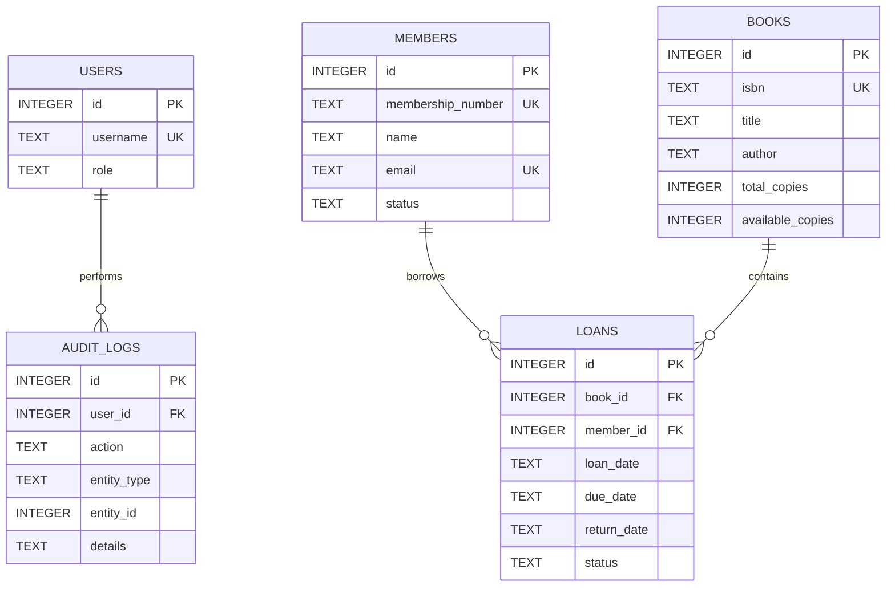
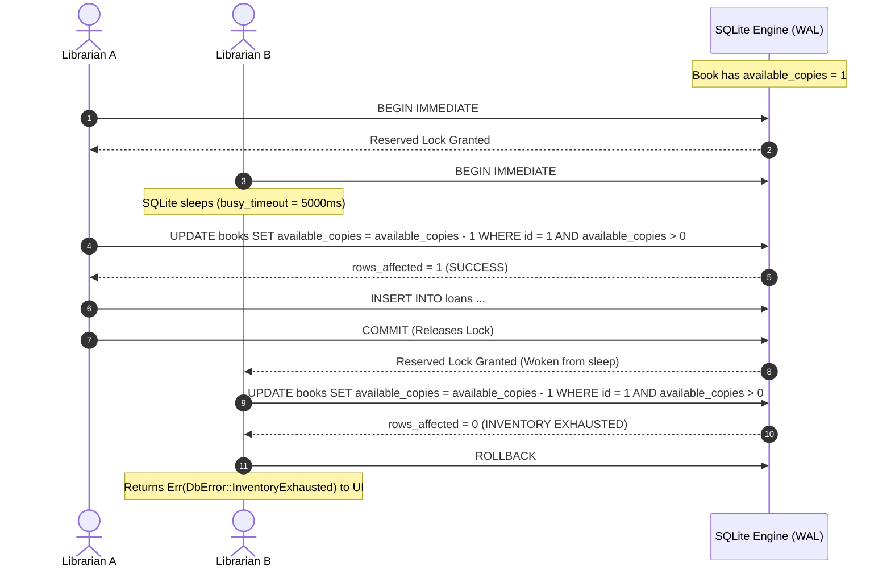

# SQLite Database Architecture & Concurrency Specification

**Application:** Professional Library Management System (Topcoat + HTMX + Tailwind)  
**Storage Engine:** SQLite 3 in WAL Mode (`rusqlite` + `r2d2` + `tokio::task::spawn_blocking`)  
**Implementation Source:**
- Connection Pool & PRAGMAs: [`src/db/mod.rs`](../src/db/mod.rs)
- Relational Schema & Seeds: [`db/schema.sql`](../db/schema.sql) and [`db/seeds.sql`](../db/seeds.sql)
- Migrations: [`src/db/migrations.rs`](../src/db/migrations.rs)
- Domain Models: [`src/db/models.rs`](../src/db/models.rs)
- Atomic Circulation Transactions: [`src/db/circulation.rs`](../src/db/circulation.rs)
- Indexed Queries: [`src/db/queries.rs`](../src/db/queries.rs)

---

## 1. Architecture Overview & Performance Principles

In a server-rendered Topcoat application, SQLite runs in-process with zero network overhead. With Write-Ahead Logging (WAL) and memory mapping, SQLite acts as an ultra-fast, high-throughput in-process relational store:

### Core Engine Principles
1. **Zero-Lock Concurrent Reads**: Readers never block writers, and writers never block readers. Any number of HTTP requests can search books and members simultaneously while a librarian commits a loan.
2. **Deterministic Single Writer**: SQLite permits only one write transaction at any microsecond. By enforcing `BEGIN IMMEDIATE` transactions, we eliminate the infamous `SQLITE_BUSY` deadlock during deferred lock upgrades.
3. **RAM-Resident Index Traversal**: Through `PRAGMA cache_size = -64000` (64MB) and `PRAGMA mmap_size = 268435456` (256MB), the library catalog B-tree resides directly in OS memory-mapped pages, reducing query latencies to sub-millisecond range.

---

## 2. Tuning Pragmas

Every SQLite connection checked out from the pool executes the following PRAGMAs:

| Pragma Directive | Setting | Performance & Durability Impact |
| :--- | :--- | :--- |
| `PRAGMA journal_mode` | `WAL` | Enables Write-Ahead Logging. Readers use snapshots while writers append to the `-wal` file. |
| `PRAGMA synchronous` | `NORMAL` | Syncs the WAL to disk at checkpoints rather than on every commit. Boosts write throughput by 10x-50x while preserving full crash durability against power loss. |
| `PRAGMA foreign_keys` | `ON` | Enforces referential integrity at the database core (prevents orphaned loans or illegal record deletions). *Set per connection.* |
| `PRAGMA busy_timeout` | `5000` | SQLite sleeps and retries automatically for up to 5,000ms when waiting for a write lock, eliminating immediate busy lock errors. |
| `PRAGMA cache_size` | `-64000` | Allocates 64MB of RAM page cache per connection. Negative values denote KiB. |
| `PRAGMA mmap_size` | `268435456` | Enables 256MB of memory-mapped I/O, allowing reads to bypass OS `read()` syscalls. |
| `PRAGMA temp_store` | `MEMORY` | Forces temporary index tables, sorting buffers, and aggregations to reside in RAM. |
| `PRAGMA wal_autocheckpoint`| `1000` | Automatically flushes WAL log pages to the main database file every 1,000 pages (~4MB). |

---

## 3. Relational Entity Relationships

*For complete column definitions and CHECK constraints, see [`db/schema.sql`](../db/schema.sql).*

---

## 4. Sub-Millisecond Indexing Strategy

To guarantee immediate responses for HTMX search inputs and circulation dashboards, targeted indexes eliminate full-table scans:

- **Books Catalog**:
  - `idx_books_isbn` (Unique): Instant ISBN-10/13 point lookups.
  - `idx_books_title`, `idx_books_author` (`COLLATE NOCASE`): Real-time case-insensitive prefix/substring searches.
  - `idx_books_category_title`: Composite index for category filtering and sorting.
  - `idx_books_available` (Partial): Index on `available_copies WHERE available_copies > 0` for fast checkout combobox searches.
- **Patrons & Members**:
  - `idx_members_membership_number`, `idx_members_email` (Unique): Fast barcode and email resolution.
  - `idx_members_name` (`COLLATE NOCASE`): Name-based autocomplete search.
- **Circulation Desk**:
  - `idx_loans_active_due_date` (Partial): `(status, due_date) WHERE status != 'returned'`. Filters out closed loans (~90% of table), keeping active/overdue checks cached in minimal memory.
  - `idx_loans_member_status`, `idx_loans_book_status`: Composite indexes for member drawer lookups and deletion guards.

---

## 5. ACID Concurrency Control (Zero Race Conditions)

To prevent double-lending race conditions when multiple librarians attempt to check out the final available copy of a title simultaneously:

*Implementation reference: [`issue_loan_tx`](../src/db/circulation.rs) and [`return_book_tx`](../src/db/circulation.rs).*
